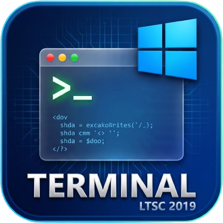

<div align="center">
  
  <h1>Windows Terminal LTSC 2019 (Thai UTF-8 Edition)</h1>
  <p><b>แอปพลิเคชันเทอร์มินัลยุคใหม่สำหรับ Windows 10 Enterprise LTSC 2019 (Build 17763) — รองรับภาษาไทยสมบูรณ์แบบ 100%</b></p>
  <p>
    <b>ผู้พัฒนา (Author):</b> Rachata &nbsp;|&nbsp;
    <b>สัญญาอนุญาต (License):</b> Free Non-Commercial (ใช้งานฟรี ห้ามจำหน่ายเชิงพาณิชย์ และห้ามลบเครดิตผู้พัฒนา)
  </p>
</div>

---

## ทำไมต้องใช้ Windows Terminal LTSC 2019?

บน **Windows 10 Enterprise LTSC 2019 (เวอร์ชัน 1809 / Build 17763)**:
1. ไม่สามารถติดตั้ง **Microsoft Windows Terminal** ตัวทางการจาก Microsoft Store ได้ (เนื่องจากต้องการ Windows 10 เวอร์ชัน 1903 Build 18362 ขึ้นไป)
2. หน้าต่าง `cmd.exe` และ `conhost.exe` เดิมของ Windows 10 LTSC 2019 มีปัญหาในการแสดงผลและรับค่าภาษาไทยแบบ UTF-8 (`CodePage 65001`) ทำให้สระลอย วรรณยุกต์ซ้อน กลายเป็นสี่เหลี่ยม `□` หรือกลายเป็นภาษาต่างดาวเมื่อพิมพ์คำสั่งภาษาไทย

**Windows Terminal LTSC 2019** จึงถูกพัฒนาขึ้นเพื่อแก้ปัญหานี้โดยเฉพาะ โดยใช้สถาปัตยกรรมที่ทำงานได้ทันทีบน Windows 10 LTSC 2019 โดยไม่ต้องลง Runtime เพิ่มเติม

---

## ดาวน์โหลดและติดตั้ง (Download & Install)

1. ดาวน์โหลดไฟล์ตัวติดตั้งแบบไฟล์เดียวจบ: **`WindowsTerminalLTSC-Setup.exe`** (จากหน้า **Releases** ของ GitHub นี้)
2. ดับเบิลคลิกเปิด **`WindowsTerminalLTSC-Setup.exe`**
3. เลือกโฟลเดอร์ที่ต้องการติดตั้ง และเลือกติ๊กตัวเลือกที่ต้องการ:
   - ☑ **ใช้แทน `cmd` เมื่อพิมพ์ในช่องที่อยู่ (Address Bar) ของโฟลเดอร์**
   - ☑ **เปิดใช้งานคำสั่งลัด `wt` (เหมือน Windows Terminal ของแท้)**
   - ☑ **เพิ่มเมนูคลิกขวา "เปิดใน Windows Terminal (ภาษาไทย)" ในทุกโฟลเดอร์**
   - ☑ **สร้างไอคอนทางลัด (Shortcut) บนหน้าจอ Desktop และ Start Menu**
4. กดปุ่ม **🚀 ติดตั้งลงเครื่องทันที (Install Now)**

### วิธีตรวจสอบความถูกต้องของไฟล์แท้ (SHA-256 Checksum Verification)
เพื่อป้องกันไฟล์ปลอมหรือไฟล์ที่ถูกดัดแปลงโดยผู้ไม่หวังดี สามารถตรวจสอบค่า Hash ของไฟล์ด้วย PowerShell:
```powershell
Get-FileHash .\WindowsTerminalLTSC-Setup.exe -Algorithm SHA256
```
แล้วเทียบค่าที่ได้กับไฟล์ [`SHA256SUMS.txt`](SHA256SUMS.txt) ในคลังซอร์สโค้ดนี้

---

## จุดเด่นและฟีเจอร์หลัก

- **รองรับภาษาไทยสมบูรณ์แบบ 100% (Full Thai Language Support)**
  - แสดงผลด้วย **DirectWrite + ระบบสลับฟอนต์ภาษาไทยอัตโนมัติ** (`Consolas, Leelawadee UI, Tahoma, Segoe UI`) พร้อมความสูงบรรทัดที่รองรับสระบน-ล่างและวรรณยุกต์ไทยครบถ้วน (`ั ิ ี ึ ื ุ ู ่ ้ ๊ ๋ ็ ์ ำ`)
  - แก้บั๊ก `cmd.exe` บน Windows 10 1809 เรื่องการรับคำสั่งภาษาไทยแบบ UTF-8 (`CodePage 65001`) ทำให้รันคำสั่งภาษาไทย เช่น `echo สวัสดีครับ`, `mkdir โฟลเดอร์ไทย`, `cd โฟลเดอร์ไทย`, `set ตัวแปร=ค่าภาษาไทย` ได้สมบูรณ์
  - สลับรหัสภาษาได้ทั้ง **UTF-8 (65001)** และ **Thai TIS-620 / Windows-874**
- **หน้าตาและฟีเจอร์ระดับเดียวกับ Microsoft Windows Terminal**
  - **Multi-Tab (หลายแท็บ)**: เปิดใช้งานทั้ง **Command Prompt (`cmd.exe`)** และ **Windows PowerShell (`powershell.exe`)** ในหน้าต่างเดียว
  - **Split Pane (แบ่งหน้าจอ 2 ฝั่ง)**: กด `Alt + Shift + D` เพื่อแบ่งหน้าจอซ้าย-ขวา
  - **Drag & Drop ไฟล์และโฟลเดอร์**: ลากไฟล์มาวางเพื่อเติม Path อัตโนมัติ หรือกด **`Shift` + ลากโฟลเดอร์มาวาง** เพื่อ `cd` เข้าโฟลเดอร์นั้นทันที
  - **Run as Administrator**: ปุ่มเปิดหน้าต่างโหมดผู้ดูแลระบบ (`Ctrl + Shift + A`) พร้อมป้ายสถานะ `🛡 ADMIN`
  - **ANSI / VT100 Colors & Themes**: รองรับสี 16 สี, 256 สี และ 24-bit TrueColor พร้อมธีมสีในตัว (`Campbell`, `One Half Dark`, `Dracula`, `Solarized Dark`, `Vintage Green`, `One Half Light`)
  - **Clickable URLs & Search Highlight**: คลิกเปิดลิงก์ `http://` / `https://` ได้ทันที และค้นหาพร้อมไฮไลต์คำด้วย `Ctrl + Shift + F`

---

## คีย์ลัด (Keyboard Shortcuts)

| คีย์ลัด | การทำงาน |
|---|---|
| `Ctrl + T` | เปิดแท็บใหม่ |
| `Ctrl + W` | ปิดแท็บปัจจุบัน |
| `Ctrl + Tab` | สลับไปยังแท็บถัดไป |
| `Ctrl + Shift + 1` | เปิดแท็บ Command Prompt (UTF-8) |
| `Ctrl + Shift + 2` | เปิดแท็บ Windows PowerShell (UTF-8) |
| `Ctrl + Shift + 3` | เปิดแท็บ Command Prompt (Thai CP874) |
| `Ctrl + Shift + A` | เปิดหน้าต่างใหม่ในโหมดผู้ดูแลระบบ (Administrator) |
| `Alt + Shift + D` | แบ่งหน้าจอซ้าย-ขวา (Split Pane) |
| `Ctrl + Shift + F` | ค้นหาและไฮไลต์ข้อความในหน้าจอเทอร์มินัล |
| `Ctrl + Shift + S` | บันทึกผลลัพธ์ในเทอร์มินัลเป็นไฟล์ UTF-8 |
| `Ctrl + L` | ล้างหน้าจอ (Clear Screen) |
| `Ctrl + ,` | เปิดหน้าต่างตั้งค่า (Settings) |
| `Ctrl + (+ / -)` หรือ `Ctrl + ล้อเมาส์` | ขยาย / ย่อขนาดตัวอักษร |
| `Up / Down` | เรียกดูประวัติคำสั่งย้อนหลัง (จำข้ามรอบการเปิดโปรแกรม) |
| `Tab` | เติมชื่อไฟล์หรือโฟลเดอร์อัตโนมัติ (รองรับชื่อไฟล์ภาษาไทย) |

---

## การคอมไพล์จากซอร์สโค้ด (Build from Source)

โปรเจกต์นี้ใช้คอมไพเลอร์ C# มาตรฐาน (`csc.exe` ของ .NET Framework 4.x) ที่ติดมากับ Windows 10 LTSC 2019 อยู่แล้ว ไม่ต้องติดตั้งโปรแกรมภายนอกเพิ่มเติม เพียงดับเบิลคลิกไฟล์ **`build.bat`** ระบบจะสร้างไฟล์:
- `WindowsTerminalLTSC.exe` (ตัวโปรแกรมหลัก)
- `WindowsTerminalLTSC-Setup.exe` (ตัวติดตั้งแบบไฟล์เดียวจบ)

---

## สัญญาอนุญาตและลิขสิทธิ์ (License & Anti-Abuse Notice)

**Copyright © 2026 Rachata. All Rights Reserved.**

ซอฟต์แวร์นี้เปิดให้ดูซอร์สโค้ดและดาวน์โหลดไปใช้งานได้ **ฟรี (Free Non-Commercial)** ภายใต้เงื่อนไขในไฟล์ [`LICENSE`](LICENSE):
1. **ห้ามนำไปจำหน่ายเชิงพาณิชย์ (No Commercial Sale)**: ห้ามนำโปรแกรม ซอร์สโค้ด หรือตัวติดตั้งไปขาย เช่า หรือเรียกเก็บเงินไม่ว่ากรณีใดๆ
2. **ห้ามลบหรือดัดแปลงเครดิตผู้พัฒนา (No Removal of Attribution)**: ห้ามลบ แก้ไข หรือปิดบังชื่อผู้พัฒนาต้นฉบับ (`Rachata`) ทั้งในซอร์สโค้ด หน้าต่างโปรแกรม และข้อมูลคุณสมบัติไฟล์ (File Properties)
3. **ห้ามแอบอ้างผลงานหรือแจกจ่ายไฟล์ดัดแปลงอันตราย (No Plagiarism / Malicious Mods)**: ห้ามแอบอ้างเป็นเจ้าของผลงาน และห้ามนำเวอร์ชันดัดแปลงไปแจกจ่ายซ้ำโดยแอบอ้างเป็นไฟล์ทางการ
